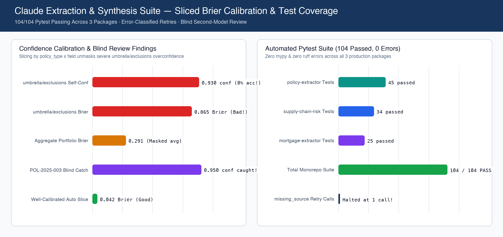

# Calibrated Document Extraction, HITL Routing & Multi-Source Synthesis Evaluation Suite

[](https://github.com/kenseiAmit/claude-extraction-eval-observability/actions/workflows/ci.yml)


-16A34A?style=flat-square&logo=pytest&logoColor=white)


Production evaluation, confidence calibration, and observability monorepo for **Anthropic Claude** structured extraction and multi-source synthesis pipelines—verified across **`104` `pytest` tests** and controlled fault-injection experiments.



---

## 1. Three-Package Architecture & Empirical Highlights

| Package | Tests | Reliability Pattern | Verified Perturbation / Calibration Result |
| :--- | :---: | :--- | :--- |
| **[`packages/policy-extractor`](packages/policy-extractor)** | `45 passed` | Error-classified retry (`missing_source` vs `format`), blind second-model reviewer, 3-signal HITL router, sliced Brier calibration | Unmasked `umbrella / exclusions` (`conf=0.93, acc=0.00, brier=0.865`) hidden behind `0.291` aggregate Brier; halted `missing_source` after `1` call instead of `4`. |
| **[`packages/mortgage-extractor`](packages/mortgage-extractor)** | `25 passed` | Two-pass classifier → nullable doc-type schema + Python cross-field arithmetic consistency validator | Caught `-$1,250.00` paystub earnings/YTD mismatch (`exit 1`); verified `consistent: true` (`exit 0`) on repaired fixture. |
| **[`packages/supply-chain-risk`](packages/supply-chain-risk)** | `34 passed` | `ReaderResult` timeout envelope isolation, `all-MiniLM-L6-v2` vector claim memory, date-guarded corroboration vs `ESCALATE` | `--simulate-timeout` degraded cleanly (`exit 0`) with zero partial-row vector pollution, surfacing `[single source only]` badges. |

---

## 2. Sample Policy Pipeline & Calibration Output ([`evaluation/01-policy-pipeline/pipeline-run.txt`](evaluation/01-policy-pipeline/pipeline-run.txt))

```text
2026-10-01 21:12:30,517 INFO HTTP Request: POST https://api.anthropic.com/v1/messages "HTTP/1.1 200 OK"
2026-10-01 21:12:35,734 INFO HTTP Request: POST https://api.anthropic.com/v1/messages "HTTP/1.1 200 OK"
2026-10-01 21:12:35,735 INFO review_disagreement policy_id=POL-2025-010 fields=['premium_amount']
{
  "decisions_written": 9,
  "auto_approve": 0,
  "human_review": 9,
  "spot_check": 0,
  "escalations": 1,
  "pattern_summary": {
    "endorsements_absent": {
      "count": 1,
      "policies": [
        "POL-2025-009"
      ],
      "categories": [
        "missing_source"
      ]
    },
    "premium_does_not_match_components": {
      "count": 1,
      "policies": [
        "POL-2025-010"
      ],
      "categories": [
        "consistency"
      ]
    }
  },
  "output_path": "routing_decisions.json"
}
exit code: 0
```

Companion architectural brief on `stop_reason` harness loops and `56.8%` context compression: [`docs/harness_engineering_case_study.md`](docs/harness_engineering_case_study.md).

---

## 3. Quick Start

```bash
(cd packages/policy-extractor && pytest)
(cd packages/mortgage-extractor && pytest)
(cd packages/supply-chain-risk && pytest)
python evaluation/calibration_report.py
```

## License

MIT License — see [LICENSE](LICENSE).
